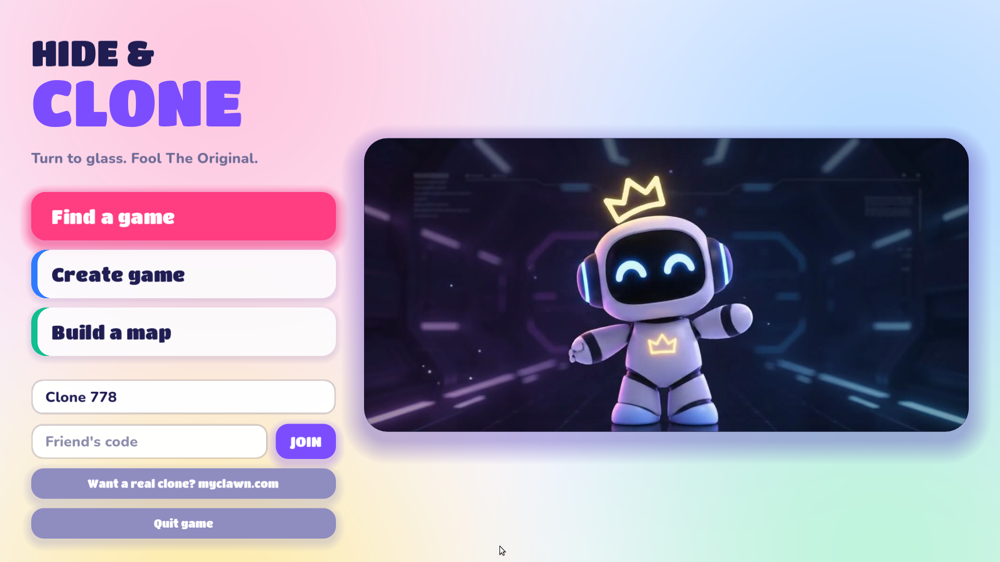
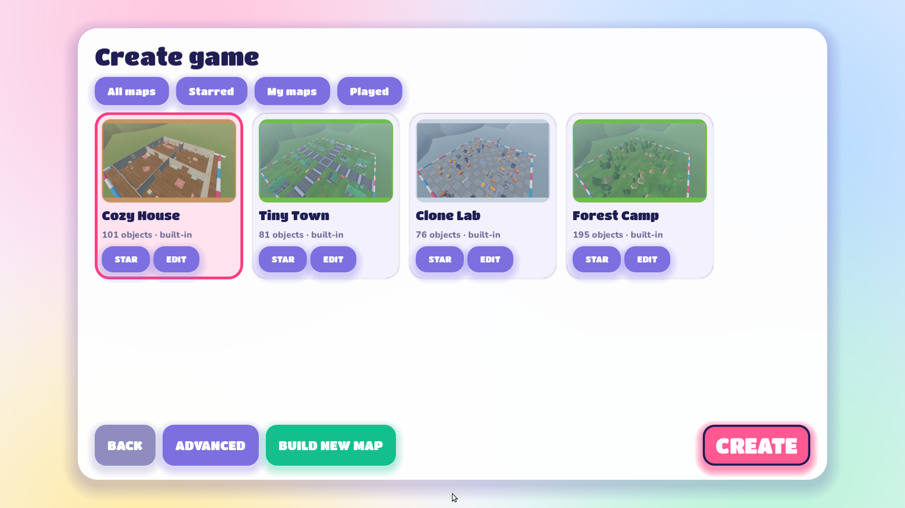
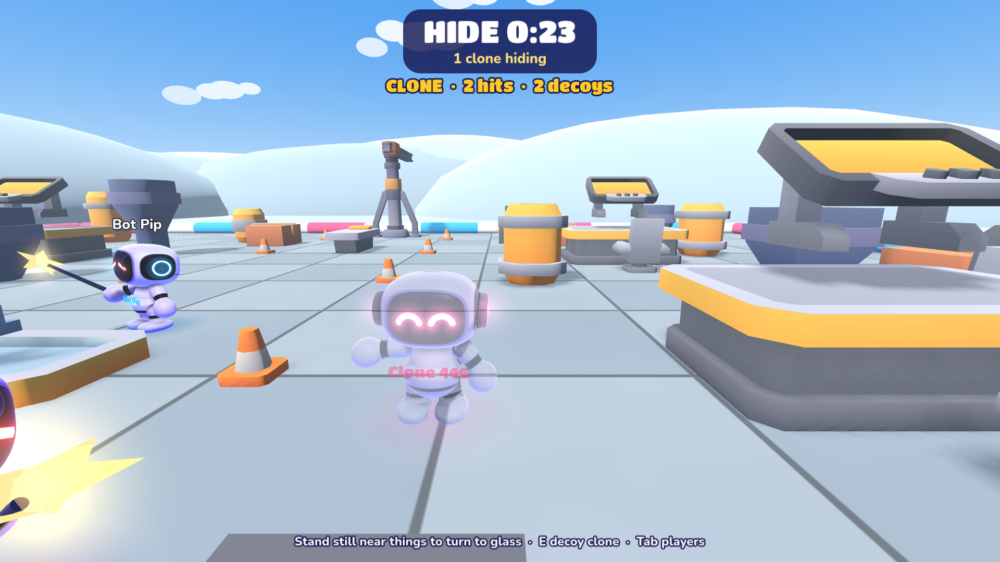

# Hide & Clone
Free hide and seek with cute glass clones. Build a map from 4,000+ free models, hit Create, invite friends.
Play: https://20vision.github.io/hide-and-clone/

## Host a game for friends
No account, no server to rent: your browser (or the Windows app) hosts the match and your friends connect to you directly.

1. Open https://20vision.github.io/hide-and-clone/, type your name in the box under the menu, then press **Create game**.

   

2. Pick a map (or **Build new map** to make your own). **Advanced** sets hiding time, round time, bots, max players and whether the lobby is public. Press **CREATE**.

   

3. You are now in your lobby. Press **Esc** (or **Start** on a gamepad) to open the menu: it shows your 5-letter **Invite code** and a **COPY INVITE LINK** button. Send the link to your friends.
4. Friends either open the link, or type the code into **Friend's code** on the main menu and press **JOIN**. Each friend takes a bot's seat, so you can start with bots and fill up as people arrive.
5. Rounds start on their own once two players are ready. If you turned off "Start rounds automatically", press **START ROUND** in the Esc menu (or **Enter**).

   

Keep your tab open: if the host leaves, the game ends for everyone.

## How it works
- One random player is The Original with a wand. Everyone else hides and turns to glass near things.
- The host's browser runs the game (WebRTC). `server/lobby.mjs` only lists lobbies and connects players.
- `tools/build_catalog.mjs` prepares the CC0 models, `tools/test_web.mjs` plays a full networked round in two browsers.
- Windows (Microsoft Store): `tools/build_msix_dir.sh` lays out `build/msix`, which `makeappx pack` turns into the Store package. Native tests: `tools/test_native.mjs`, `tools/test_native_input.sh`, `tools/test_native_pad.sh`.
By MyClawn (https://www.myclawn.com).
